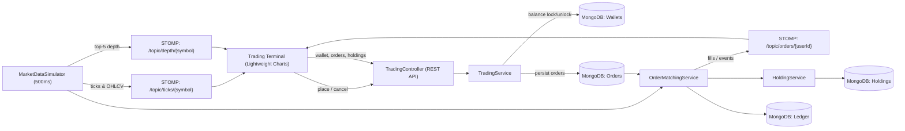

# TradePulse — Real-Time Algorithmic & Institutional Trading Engine


TradePulse is a demo trading platform built around real-time market streams, guarded order execution, portfolio tracking, and an interactive browser trading terminal. It combines Spring MVC REST APIs, MongoDB persistence, a tick-driven matching engine, STOMP over SockJS, and Lightweight Charts.

> **Version note:** The repository's `pom.xml` currently targets Java 17 source compatibility and declares Spring Boot 4.1.2. The Docker images use Java 21 as requested; running this application on Java 21 does not change its configured Java source target. The Spring Boot badge reflects the checked-in Maven parent rather than the originally proposed Boot 3 baseline.

## Architecture & system design



### Core engineering highlights

- **Multi-stream market simulation:** AAPL, NVDA, MSFT, RELIANCE, and INFY ticks are emitted every 500 ms. Five-second OHLCV bars and simulated Level 2 depth snapshots accompany the market feed.
- **Atomic cash and share reservation:** MongoDB conditional updates guard available cash and unreserved share quantities, preventing competing requests from spending or reserving the same balance.
- **Tick-driven limit matching:** Pending limit orders are checked against the matching symbol's incoming market price. MARKET orders are submitted to immediate execution and settlement.
- **Full trade lifecycle:** BUY orders reserve cash and add filled shares to holdings; holdings are valued against live prices; SELL/exit orders settle proceeds and realized P&L; cancelling a pending order unlocks cash or releases reserved shares.
- **Auditable money movement:** Wallet locks, cancellation unlocks, and equity sale credits are recorded as ledger entries.
- **Live trading UI:** Symbol-aware STOMP subscriptions feed the watchlist, chart, depth ladder, and order-status updates. The chart supports line/candlestick views and OHLCV hover details.

## API reference

The application listens on port `8081`. JSON request examples use the demo user's `demo-user` identifier.

| Method | Path | Payload / parameters | Description |
|---|---|---|---|
| `GET` | `/api/wallet/{userId}` | Path: `userId` | Returns the user's INR wallet, creating the demo wallet if needed. |
| `POST` | `/api/orders` | JSON below | Places a BUY or SELL LIMIT/MARKET order. Returns `order`, updated `wallet`, and `holdings`. |
| `GET` | `/api/orders/{userId}` | Path: `userId` | Returns up to 100 recent orders, newest first. |
| `DELETE` | `/api/orders/{orderId}?userId={userId}` | Path: `orderId`; query: `userId` | Cancels a user's PENDING order and returns the cancelled `order` and updated `wallet`. |
| `GET` | `/api/holdings/{userId}` | Path: `userId` | Returns the user's active holdings. |

Example order request:

```json
{
  "userId": "demo-user",
  "symbol": "AAPL",
  "side": "BUY",
  "orderType": "LIMIT",
  "price": 2475.00,
  "quantity": 1
}
```

`side` is `BUY` or `SELL`; `orderType` is `LIMIT` or `MARKET`. Order statuses include `PENDING`, `FILLED`, `REJECTED`, and `CANCELLED`. Invalid order input and insufficient shares return `400`; insufficient wallet funds return `409`; a missing order or an order not owned by the supplied user returns `404`; an order that is no longer cancellable returns `400`.

## STOMP topic schema

Connect through the SockJS endpoint `/ws-market` and subscribe to the topics below.

| Topic | Message shape | Description |
|---|---|---|
| `/topic/ticks/{symbol}` | `{ "symbol", "price", "open", "high", "low", "close", "volume", "tickVolume", "barTime", "timestamp" }` | Live price and current five-second OHLCV bar for a watchlist symbol. |
| `/topic/depth/{symbol}` | `{ "symbol", "bids", "asks", "totalBuyQuantity", "totalSellQuantity", "buyPercentage", "sellPercentage", "timestamp" }` | Simulated five-level bid and ask snapshot, with quantities, order counts, and ratio. |
| `/topic/orders/{userId}` | Order object | User-specific order status notifications, including fills, rejections, and cancellations. |

## Local development

### Prerequisites

- Java 21 (the project compiles to its configured Java 17 source target)
- MongoDB 7 listening on `localhost:27017`, or Docker with Compose
- Git

Start the application with a local MongoDB instance:

```powershell
.\mvnw.cmd spring-boot:run
```

On macOS/Linux:

```bash
./mvnw spring-boot:run
```

Run the test suite:

```powershell
.\mvnw.cmd clean test
```

```bash
./mvnw clean test
```

The browser UI is served by Spring Boot at [http://localhost:8081/](http://localhost:8081/). The default MongoDB connection is `mongodb://localhost:27017/tradepulse_db`; configure `SPRING_DATA_MONGODB_URI` to override it.

## Docker deployment

Build the multi-stage image and start MongoDB and the backend:

```bash
docker compose up --build
```

Compose starts `tradepulse-backend` after MongoDB's health check succeeds. MongoDB data persists in the named `mongodb_data` volume; both services communicate over the isolated `tradepulse-network` bridge.

- Trading terminal and REST API: [http://localhost:8081/](http://localhost:8081/)
- MongoDB: `mongodb://localhost:27017/tradepulse_db`

Stop the containers while retaining database data:

```bash
docker compose down
```

To delete the persisted demo database as well, run `docker compose down --volumes`. MongoDB is configured without authentication for local demo use; configure credentials, network restrictions, secrets, and production-grade operational controls before exposing this stack outside a trusted development environment.
